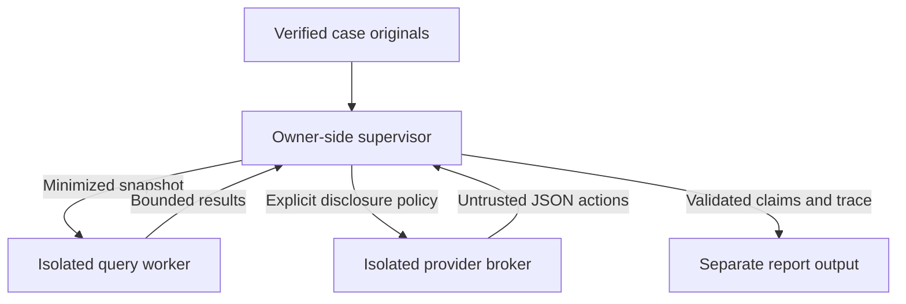

# ADR-002 — Bounded, provider-independent investigation

Status: accepted for the experimental vertical slice, 2026-10-23. Extends [ADR-001](ADR-001-runtime-and-language-selection.md); no replacement language or agent framework. Implementation checkpoint: `c9a16e1`; subsequent qualification changes remain on the same reviewable PR. No automatic merge.

## Decision and executable boundaries

Keep deterministic forensics independent of AI. Add a small original supervisor, versioned JSON actions, a fixed read-only tool worker and a separate provider broker. The model proposes queries; executable policy decides whether they are permitted. It never receives a case-store object, filesystem path, device library, credential, shell or plugin registry.

The supervisor verifies stored structure, original bytes, reparsed events and any saved analysis. It selects a chronological snapshot, aliases identifiers by default, and binds its digest to the source-state digest. The worker receives this snapshot once over a private pipe. Neither model arguments nor subsequent tool calls can change its case, redaction settings or snapshot. Original files and source state are reverified after the investigation; concurrent case changes fail the operation.

On Linux, after trusted imports and before processing model actions, the worker clears its environment, disables core dumps and privilege gain, and installs a default-deny libseccomp filter. Only its pipes and runtime memory/time syscalls remain available. File opens, new sockets/connections, process creation/execution and ptrace are absent. Limits: 512 MiB address space, 20 CPU seconds, zero file growth. Parent deadlines kill and reap the worker. Tests attempt actual opens, overwrites, unlink, sockets, fork and execution and require kernel permission failures. This is a demonstrated OS boundary, not a system-prompt convention.

Seccomp alone is [not a complete sandbox](https://docs.kernel.org/userspace-api/seccomp_filter.html). The owner-side supervisor, installed package, interpreter/native libraries and kernel remain trusted. Import/parsing still runs in the owner process with bounded JSON input. A hostile same-UID process or root can change the case or parent; the design does not isolate different human operators on one compromised host. Stronger identities/VMs and archive-parser containment remain separate gates. On unsupported hosts or failed policy installation, investigation fails closed; it never silently runs unconfined.

## Modes and provider choice

| Mode | Implemented behavior | Qualification |
|---|---|---|
| A: deterministic offline | Existing analysis/privacy reports plus `diagnostics report`; no provider or network required | Generated fixtures, source-location checks, existing regression suite |
| B: local model | Explicit private configuration, literal loopback HTTP endpoint, same bounded JSON action loop | Real HTTP broker tested with a synthetic server; actual local model inference untested |
| C: external model | Public HTTPS destination, verified TLS, exact disclosure consent required before provider construction/credential access | Consent, destination rules, transport and local TLS certificate validation tested; no external model request made |

The default `mock` adapter demonstrates planning, six evidence queries (when a finding exists), alternative comparison and a grounded final report. It is scripted and is not evidence of model intelligence. `chat-completions-json` uses the non-streaming `/v1/chat/completions` subset, requests JSON content, and interprets it as the SCRYVEIL action contract. There is no implicit provider tool execution. The `Provider.next(messages) -> Reply(action, usage)` boundary permits future separately reviewed adapters; owner configuration cannot import arbitrary Python classes.

Research compared a minimal adapter, provider SDKs, native provider-specific APIs, local servers and general agent frameworks. [Ollama's documentation](https://docs.ollama.com/api/openai-compatibility) supports this HTTP subset, but also permits cloud-backed models through a local server. Loopback proves only the first hop. Operators must select local weights/resources and independently prevent server egress to claim offline operation. [llama.cpp at 4231b23](https://github.com/ggml-org/llama.cpp/blob/4231b23dc2c46661d01157aac5245bdcf03ce4b1/tools/server/README.md) documents JSON responses and cautions about compatibility and chat templates. Neither server was installed or exercised here; model and weight licenses need their own review.

Native Responses/Messages APIs could improve structured output, caching and accounting, but need different request/response, refusal and token semantics. They are not claimed compatible with this adapter. No unique native feature was required by the slice. SDK retries, telemetry, implicit environment/proxy behavior and broad tool registries would enlarge the trusted surface. A framework or multiple agents has no measured benefit here, so none was added. A future adapter must pass the same adversarial and consent tests before being enabled. This is an engineering trade-off, not a claim that frameworks are inherently unsafe.

## Disclosure, credentials and recovery

Configuration alone never sends anything. `investigate preview` computes the exact scope: endpoint/model, question, selected artifact/event/finding counts, field categories, snapshot size, omitted events, identifier flag and request budgets. Remote `run` requires the matching `consent_sha256`; changing the case, question, destination, minimization or budget invalidates it. The digest is a CLI acknowledgment of this disclosure, not a signed human identity or revocable server-side consent record.

Raw file bytes, filenames, case labels and unrelated cases are excluded. The model receives only queried snapshot projections, schemas, its previous actions and the question. The context may repeat evidence. Hashes, timestamps, relationships and a revealing question are still sensitive. Optional identifier inclusion broadens the snapshot and requires a different consent digest. This first slice supports field minimization and an earliest-event cap, not arbitrary row-by-row redaction.

Credentials are read only from an explicitly named `SCRYVEIL_…` environment variable; no inline key, key file, `.env` loading or general environment access. The supervisor sends a selected credential to the disposable broker through stdin, never to model messages or the investigator. The broker resolves once, rejects any non-public remote DNS address, connects to a numeric destination, and verifies the configured TLS hostname. It installs its syscall policy before consuming TLS records or HTTP responses. Only that connected socket and pipes remain usable. Redirects, proxies, provider-supplied URLs, cookies and automatic retries are unsupported.

Request count, context bytes, output token request, total estimated token reservation, response bytes and time are bounded. Token reservation uses serialized context bytes plus requested output tokens, not a model-specific tokenizer; it is not a billing cap. Reported usage over the budget stops further steps. Missing usage is explicitly incomplete, never a false zero. Optional cost estimates use owner-configured rates and provider-reported counts; they are not invoices. Ctrl-C/timeouts/provider errors return a partial report after cleanup when startup succeeded. There is no automatic resume or retransmission; a rerun is explicit and revalidates consent.

## Claims and uncertainty

The first action is a bounded plan. At least two successful distinct query tools are required before a final action. Models can adapt subsequent queries to earlier results. Facts must reproduce an actually available, queried event field exactly, including JSON type. The worker adds its artifact hash identity, exact byte region, source locator and process JSON pointer. Measurements reference queried deterministic finding IDs; the worker supplies their original content. Forged references, invented values, unknown tools and extra arguments fail with structured errors.

Free-form hypotheses and their confidence justification remain `unresolved_model_hypothesis`, with entailment explicitly unverified. Valid references are necessary but do not establish causal truth, maliciousness or attribution. Supporting and contrary evidence remain separate. Plans and unanswered questions are also untrusted model text. Deterministic findings and original records are never overwritten. No absence-of-IOC or absence-of-crash statement establishes a clean device.

## Contracts and extensibility

[Tool inputs](../../schemas/investigator-tools-v1.schema.json), [per-tool outputs](../../schemas/investigator-results-v1.schema.json), [actions](../../schemas/investigator-action-v1.schema.json), [provider config](../../schemas/provider-v1.schema.json), [reports](../../schemas/investigation-v1.schema.json) and [extension declarations](../../schemas/extension-v1.schema.json) are versioned. Runtime validation also enforces state, reference equality, byte limits and permissions that JSON Schema alone cannot express. The worker does not fetch schemas from the network.

[Built-in declarations](../../extensions/builtins-v1.json) identify code provenance, compatibility, license, capabilities, permissions, budgets and side effects. These describe reviewed built-ins; they do not implement a hot-loading plugin system or grant authority. Parsers, acquisition, detectors, investigator tools, providers and presentation remain separate responsibilities. Changes require reviewed source and schema updates. Acquisition adapters must declare device-side effects individually; generic Apple libraries contain write operations.

MCP may eventually make a vetted tool surface reusable by another host, but it adds transport, identity and discovery concerns without improving this single-process owner workflow. Its [security guidance](https://modelcontextprotocol.io/docs/2025-11-25/tutorials/security/security_best_practices) addresses confused deputies, SSRF, sessions and local server compromise; annotations are not enforcement. No MCP server, arbitrary plugin installation, browser tool, research tool or outbound messaging tool is exposed to the investigator. Revisit only with a concrete client need and a scoped threat model.

## Consequences and open gates

The complete slice is testable without AI credits and preserves the existing offline formats. Its OS isolation is Linux-specific and dynamically requires system libseccomp; no second authored implementation language or vendored native binary was introduced. Real IPS exports, per-version semantics, actual model utility, remote-provider behavior/retention, external security review and cross-platform isolation remain unqualified. The new pipeline measurements qualify bounded local workloads, not general forensic scalability. See [capability assessment](../capability-assessment.md), [operator guide](../investigation.md) and [validation](../validation/investigation-results.md).
